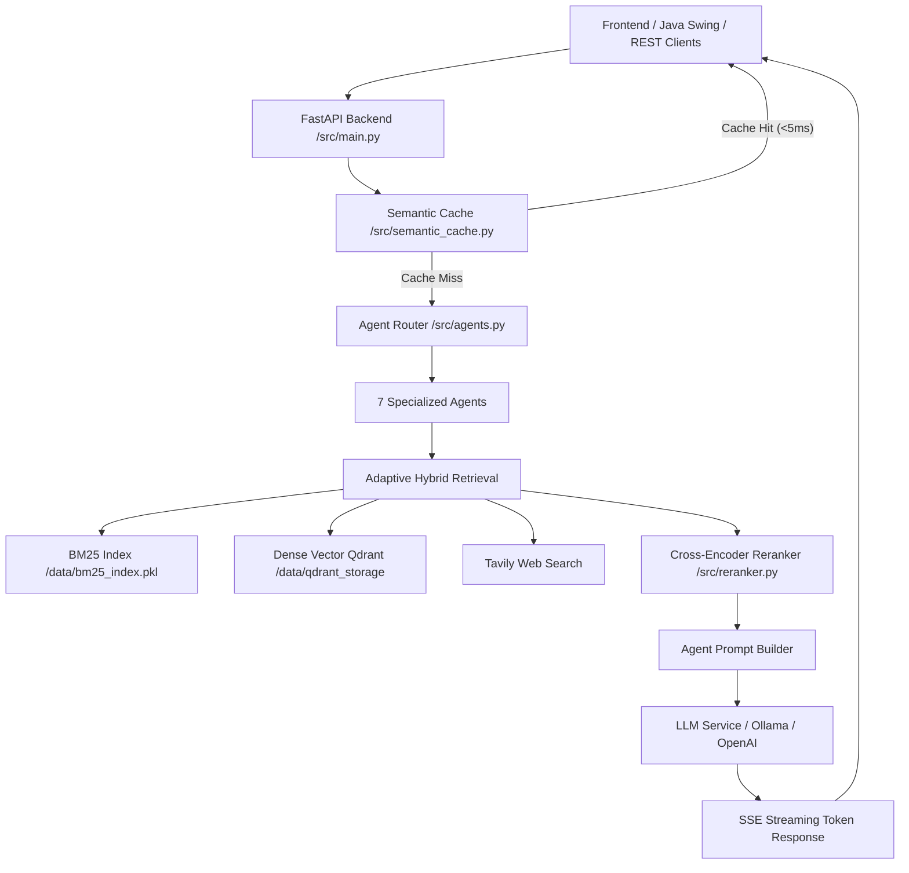

# Architecture Specification: FBC4SAO

> **FBC4SAO: A Framework of Building Chatbot to Advise on Extracurricular Activities for Study Abroad Orientation**

---

## 1. Tổng Quan Kiến Trúc (Architecture Overview)

Hệ thống được thiết kế theo kiến trúc **Adaptive Agentic RAG** phân tầng (Layered Architecture):

---

## 2. Các Phân Hệ Chính (Core Subsystems)

### 2.1 Backend Core (`src/`)
* **`main.py`**: Điểm vào chính của FastAPI backend, cấu hình SSE endpoints `/query/stream`, quản lý session và lịch sử hội thoại.
* **`agents.py`**: Định nghĩa 7 Agent chuyên trách theo mã Holland RIASEC và hàm `route_question` phân loại ý định người dùng.
* **`vector_db.py`**: Quản lý kết nối Qdrant, nạp vector embedding, tìm kiếm Dense Vector và tìm kiếm BM25 qua RRF.
* **`reranker.py`**: Tái sắp xếp độ ưu tiên của các chunks truy xuất trước khi đưa vào context prompt của LLM.
* **`semantic_cache.py`**: Bộ đệm ngữ nghĩa SQLite lưu embedding các câu hỏi đã trả lời, tự động trả lời lại các câu tương tự mà không cần gọi LLM.
* **`llm_service.py`**: Giao tiếp trừu tượng hóa với các nhà cung cấp LLM (OpenAI API, Ollama local model).
* **`conversation_store.py`**: Quản lý lưu trữ trạng thái phiên làm việc và lịch sử trò chuyện bằng SQLite.

### 2.2 Đánh Giá & Kiểm Thử (`eval/`)
* **`thesis_eval.py`**: Đánh giá 4 chỉ số chất lượng đề tài trên 100 câu hỏi chuẩn hóa ([`ground_truth_final.json`](eval/ground_truth_final.json)).
* **`comparative_eval.py`**: So sánh 4 pipeline (Standalone LLM, Naive RAG, Hybrid RAG, Adaptive Agentic RAG).

### 2.3 Giao Diện & Client (`frontend/`)
* **`HollandRAGGUI.java`**: Giao diện ứng dụng máy tính xây dựng bằng Java Swing, giao tiếp backend qua HTTP SSE streaming.

---

## 3. Tài Liệu Tham Khảo Thêm
* Chi tiết thiết kế: [`docs/OVERVIEW.md`](docs/OVERVIEW.md)
* Kiến trúc chi tiết: [`docs/system_architecture.md`](docs/system_architecture.md)
* Sơ đồ luồng: [`DIagram/`](DIagram/)
