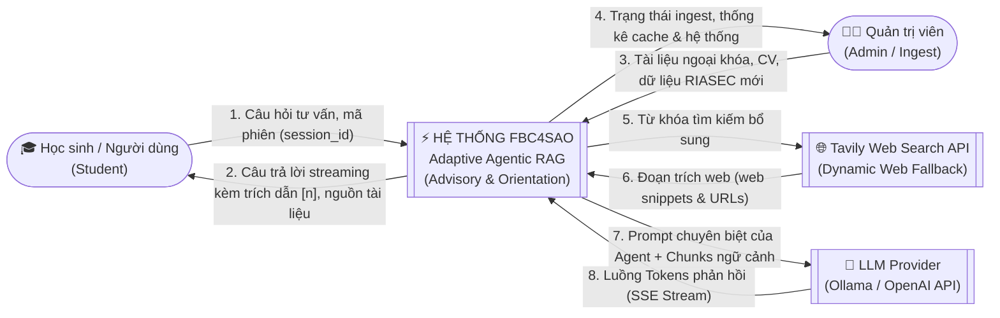
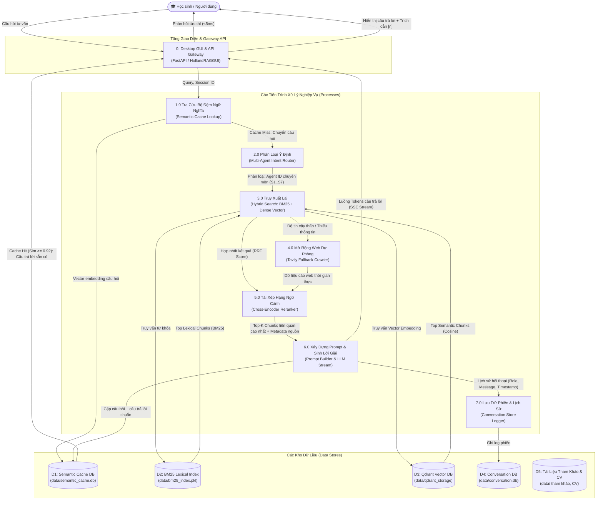
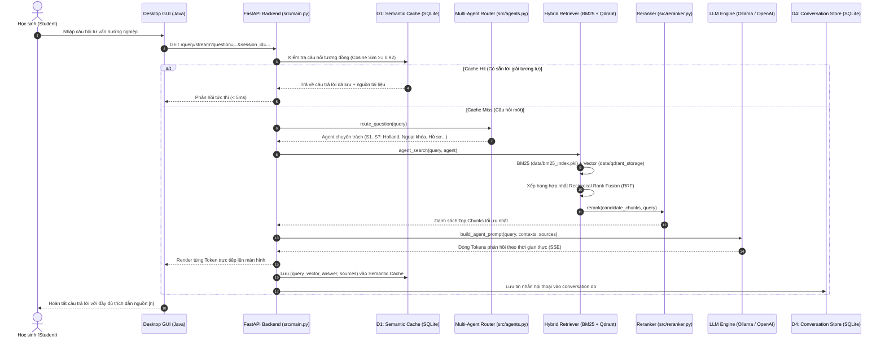

# Data Flow Diagram (Sơ đồ Luồng Dữ Liệu) — FBC4SAO

> Tài liệu mô tả chi tiết đường đi của dòng dữ liệu (Data Flows) qua các tầng kiến trúc của hệ thống **FBC4SAO: Adaptive Agentic RAG**.
> Sơ đồ thể hiện rõ: **Tác nhân ngoài (External Entities)**, **Các tiến trình xử lý (Processes)**, **Các kho dữ liệu (Data Stores)** và **Dữ liệu truyền tải giữa các thành phần**.

---

## 1. Sơ đồ Luồng Dữ liệu Cấp 0 (Context Diagram - Level 0)

---

## 2. Sơ đồ Luồng Dữ liệu Chi tiết Cấp 1 (DFD Level 1)

---

## 3. Sơ đồ Luồng Dữ Liệu Tuần Tự (Sequence Trace)

---

## 4. Bảng Phân Tích Kho Dữ Liệu (Data Stores Matrix)

| Ký hiệu | Tên Kho Dữ Liệu | Đường dẫn vật lý | Tiến trình Ghi (Write) | Tiến trình Đọc (Read) | Mô tả & Định dạng |
|:---:|---|---|---|---|---|
| **D1** | **Semantic Cache** | `data/semantic_cache.db` | Tiến trình 6.0 (LLM Generator) | Tiến trình 1.0 (Cache Lookup) | SQLite lưu `(query_text, query_embedding, answer, sources, timestamp)` phục vụ tra cứu nhanh <5ms |
| **D2** | **BM25 Lexical Index** | `data/bm25_index.pkl` | Script Ingest dữ liệu ban đầu | Tiến trình 3.0 (Hybrid Search) | Pickle file chứa bộ chỉ mục từ khóa Okapi BM25 của toàn bộ kho tài liệu |
| **D3** | **Dense Vector DB** | `data/qdrant_storage` | Script Ingest dữ liệu ban đầu | Tiến trình 3.0 (Hybrid Search) | Qdrant Vector Storage lưu trữ vector embedding (dim=1536) và payload metadata của các chunks |
| **D4** | **Conversation Store** | `data/conversation.db` | Tiến trình 7.0 (Session Logger) | Tầng API Gateway | SQLite lưu bảng `messages (id, session_id, role, content, created_at)` quản lý lịch sử hội thoại |
| **D5** | **Reference Documents** | `data/` (`CV/`, `tham khảo/`) | Quản trị viên nạp thủ công | Script Ingest dữ liệu | Kho tài liệu nguồn: bài báo Holland, hồ sơ học sinh du học 10 năm, dữ liệu chuẩn RIASEC 145k |
